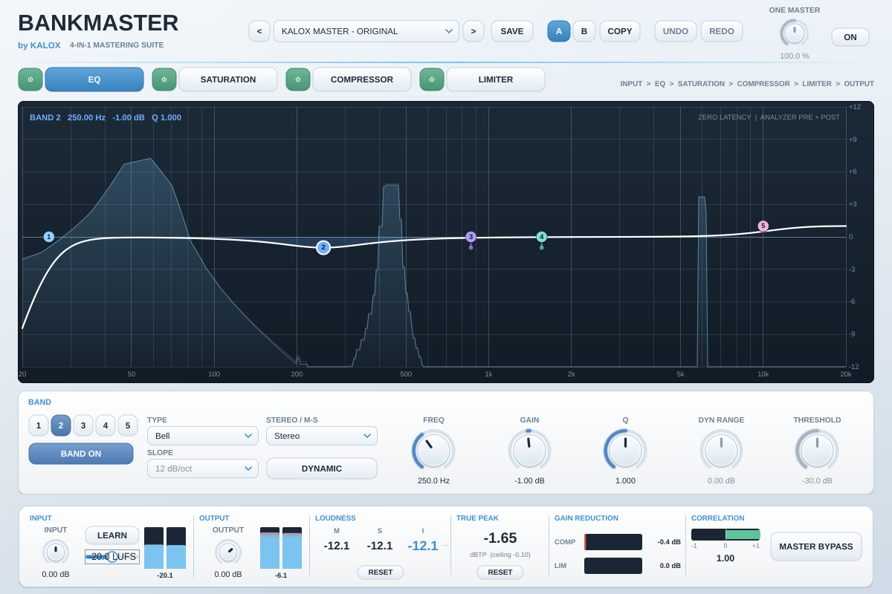
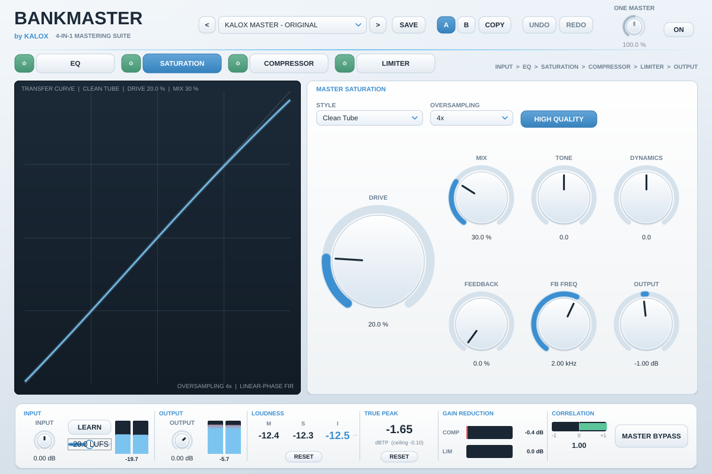
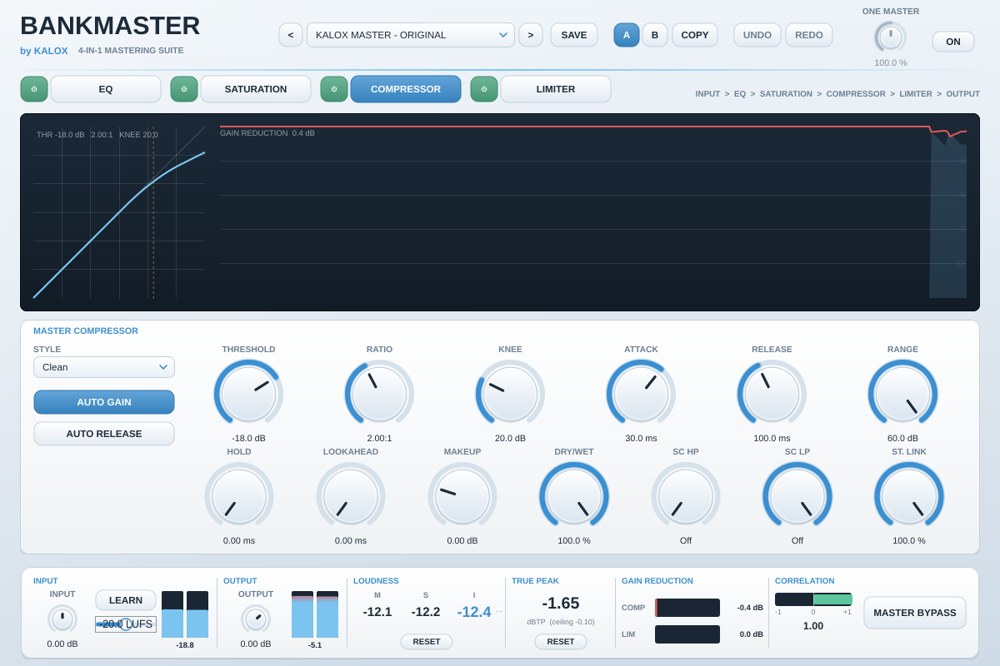
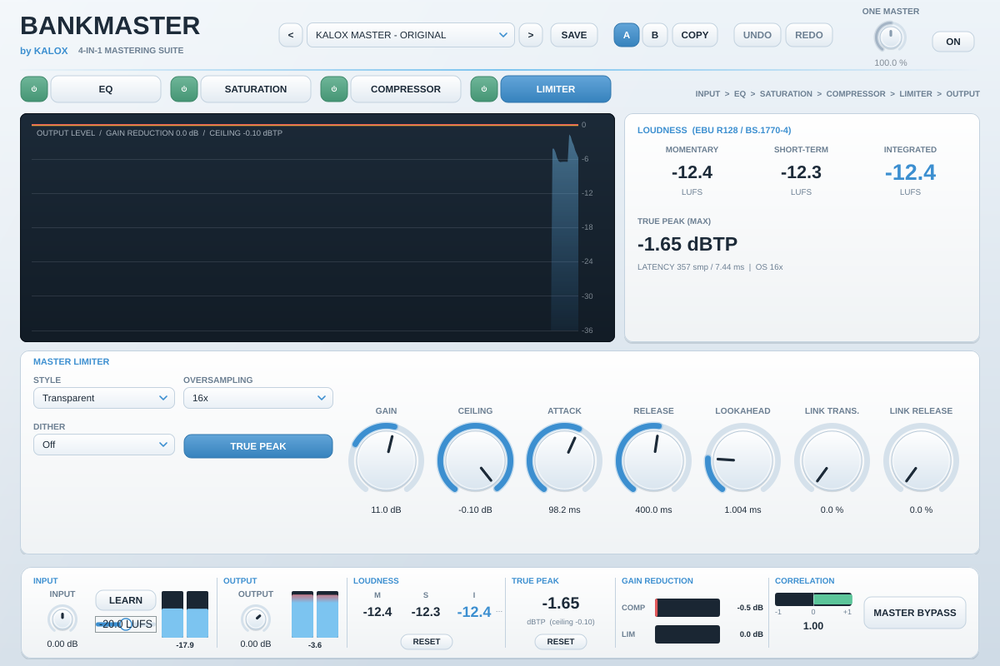

# BANKMASTER by KALOX — 4-IN-1 MASTERING SUITE

Plugin de masterização com quatro processadores em uma única instância:

**INPUT → MASTER EQ → MASTER SATURATION → MASTER COMPRESSOR → MASTER LIMITER → OUTPUT**

Formatos: VST3 · Audio Unit · Standalone — macOS universal (Apple Silicon + Intel, 10.15+).
Arquitetura portátil (Windows x64 VST3 e Linux VST3 já compilam e passam nos testes no CI).
Todo o DSP é implementação própria (sem código, interface ou algoritmo de terceiros), funciona offline
e não depende de plugins FabFilter instalados.



| Saturação | Compressor | Limiter |
|---|---|---|
|  |  |  |

## Instaladores

| Plataforma | Arquivo | Conteúdo |
|---|---|---|
| macOS Universal (arm64 + x86_64) | `BANKMASTER-by-KALOX-1.0.0-macOS-Universal.dmg` | instalador guiado (.pkg) VST3 / AU / Standalone, Read Me, desinstalador |
| Windows 10/11 x64 | `BANKMASTER-by-KALOX-1.0.0-Windows-x64-Setup.exe` | assistente gráfico: VST3 / Standalone, desinstalador |

Gerados e testados (instalação + desinstalação reais) pelo GitHub Actions. Ainda **sem assinatura digital**
— detalhes em `docs/INSTALLERS.md`.

## Uso rápido (Ableton Live 12)

1. Instale pelo DMG (macOS) ou Setup.exe (Windows) e faça *Rescan* dos plugins.
2. Coloque **uma instância** de BANKMASTER na Master. Ela abre no preset **KALOX MASTER - ORIGINAL**.
3. Toque o trecho mais alto da música, clique **LEARN** (painel INPUT), espere alguns segundos e clique de
   novo: o ganho de entrada é ajustado para que a mix chegue à cadeia em −20 LUFS — o preset se comporta
   igual em músicas com níveis diferentes (o +11 dB do limiter continua ajustável).
4. Ajuste cada módulo nas abas **EQ | SATURATION | COMPRESSOR | LIMITER** (o botão ⏻ de cada aba liga/desliga
   o módulo sem clique), ou ligue **ONE MASTER** e use um único knob (100 % = como ajustado).
5. Monitore LUFS (M/S/I), TRUE PEAK, redução de ganho e correlação na barra inferior.
6. **SAVE** salva presets de usuário; **A/B / COPY**, **UNDO / REDO** para comparar e voltar atrás.
7. Exporte pela DAW normalmente — a latência (7,4 ms @ 48 kHz no preset KALOX) é compensada pelo Live.

EQ: arraste os nós (Shift = só frequência), roda do mouse = Q, duplo clique no nó = liga/desliga,
duplo clique no fundo = nova banda.

## Presets

| Preset | Observação |
|---|---|
| KALOX MASTER - ORIGINAL | parâmetros dos seus prints (confirmados + estimados, ver `docs/PARAMETERS.md`) |
| AFRO HOUSE / DEEP HOUSE / TECH HOUSE / CLUB MASTER | pontos de partida; ≈ −9 / −10 / −8,5 / −7,5 LUFS-I com entrada em −20 LUFS |
| TRANSPARENT MASTER | processamento leve, ≈ −12 LUFS-I |
| CUSTOM USER PRESET | base neutra (teto −1 dBTP, ≈ −14 LUFS-I) para criar o seu |

Presets são pontos de partida, não garantia de master pronto para qualquer plataforma.
O teto −0,1 dBTP é o do seu preset; para streaming é comum −1 dBTP.

## Compilar

macOS (Xcode CLT + CMake ≥ 3.22):

```bash
scripts/build_macos.sh              # universal arm64+x86_64, testes (nativo + Rosetta), auval, pluginval
installer/macos/build_pkg.sh        # dist/BANKMASTER-by-KALOX-1.0.0-macOS-universal.pkg
```

Nada é instalado automaticamente (`COPY_PLUGIN_AFTER_BUILD FALSE`); o instalador só grava
`BANKMASTER.vst3`, `BANKMASTER.component` e `BANKMASTER.app` — KaloxStart e KaloxSooth não são tocados.
Assinatura Developer ID / notarização: variáveis `BM_SIGN_APP`, `BM_SIGN_INSTALLER`, `BM_NOTARY_PROFILE`
(sem elas o pacote sai com assinatura ad-hoc e o macOS pede confirmação na instalação).

Linux / Windows: `cmake -S . -B build -DCMAKE_BUILD_TYPE=Release && cmake --build build --config Release`.
JUCE 8.0.4 é baixado automaticamente (ou use `-DBANKMASTER_JUCE_DIR=/caminho/JUCE`).

Testes: `build/bankmaster_dsp_tests` e `build/bankmaster_plugin_tests_artefacts/Release/bankmaster_plugin_tests`.
Render/comparação offline: `bankmaster_render --help`.

## Documentação

- `docs/PARAMETERS.md` — parâmetros confirmados, estimados e pendentes dos prints
- `docs/ARCHITECTURE.md` — DSP, tempo real, latência, estrutura de arquivos
- `docs/TEST_REPORT.md` — os 15 testes exigidos com resultados medidos
- `docs/FINAL_REPORT.md` — relatório final (arquivos, testes, limitações, pendências)
- `docs/INSTALLERS.md` — instaladores DMG / EXE, testes de instalação, assinatura

## Licenças

Construído com JUCE (https://juce.com) sob os termos da licença JUCE — para distribuição comercial,
verifique o plano JUCE adequado. VST é marca da Steinberg; Audio Units, da Apple. FabFilter, Pro-Q,
Saturn, Pro-C e Pro-L são marcas da FabFilter B.V.; o BANKMASTER não é afiliado à FabFilter.
