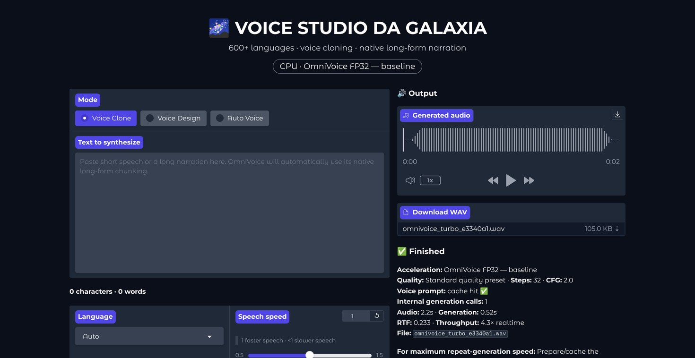

# 🌌 VOICE STUDIO DA GALAXIA

Réplica do **OmniVoice Turbo Studio** (mesmo layout, controles, parâmetros e fluxos das capturas de
referência) rodando o motor **oficial [k2-fsa/OmniVoice](https://github.com/k2-fsa/OmniVoice)** no
Google Colab. A única mudança de identidade é o título.



## Início rápido (Google Colab)

1. Abra `VOICE_STUDIO_DA_GALAXIA.ipynb` no Colab (`Arquivo → Fazer upload de notebook`, ou pelo GitHub em
   `colab.research.google.com/github/<usuário>/<repositório>/blob/<branch>/VOICE_STUDIO_DA_GALAXIA.ipynb`).
2. `Ambiente de execução → Alterar o tipo de ambiente de execução → GPU T4`.
3. `Ambiente de execução → Executar tudo` e autorize o Google Drive quando pedido.
4. Clique no link impresso pela célula **6** (proxy do Colab ou link público `gradio.live`).

A primeira execução baixa os pesos (~alguns GB) para `MyDrive/VOICE_STUDIO_DA_GALAXIA/models`.
Nas próximas sessões: **Executar tudo** de novo — os pacotes são reinstalados (o Colab apaga o ambiente),
mas pesos, vozes em cache, WAVs e configurações vêm do Drive.

### Células do notebook

| # | Célula | O que faz |
|---|---|---|
| 0 | Configurações | Drive, modelo, origem do OmniVoice, FlashInfer, link público, restaurar configurações |
| 1 | Verificar GPU e ambiente | `nvidia-smi`, versão do torch/CUDA, capacidade da GPU |
| 2 | Montar o Google Drive | cria `models/ hf_cache/ voices/ outputs/` e aponta o cache do Hugging Face para o Drive |
| 3 | Instalar dependências | OmniVoice (commit oficial fixado), Gradio 5.49.1, normalização de texto, FlashInfer quando compatível — sem trocar o torch do Colab |
| 3.b | Código do estúdio | grava `voice_studio/` (`%%writefile`) |
| 4 | Baixar e carregar o OmniVoice | `snapshot_download` para o Drive + carregamento FP16 (reaproveita o modelo se a célula for repetida) |
| 5 | Preparar componentes | aquecimento da GPU, lista de vozes em cache, configurações restauradas |
| 6 | Iniciar o Gradio | servidor em segundo plano + links (repetir a célula reinicia a interface) |

## O que a interface faz

* **Mode**: Voice Clone · Voice Design · Auto Voice (`model.generate` com `voice_clone_prompt`, `instruct` ou nada).
* **Text to synthesize** com contador de caracteres/palavras; **Optional expression tag** + **Insert Tag**
  (insere `[laughter]`, `[sigh]`… na posição do cursor).
* **Language** (600+ idiomas do OmniVoice, `Auto` por padrão) e **Speech speed** (0.5–1.5).
* **Voice Clone**: referência (upload ou microfone, player com waveform), **Exact reference transcript**
  (vazio = transcrição automática com Whisper), **Prepare / Cache Voice**, **Clear Voice Cache** e o indicador
  **Voice cached**. O `VoiceClonePrompt` fica em memória e no Drive (`voices/*.pt`), então a mesma referência
  não é recodificada nem em sessões futuras.
* **Long-form Narration**: `audio_chunk_duration` (15 s) e `audio_chunk_threshold` (30 s) — a segmentação e a
  união do áudio são as do próprio OmniVoice.
* **Quality / Advanced Settings**: steps 32, CFG 2.0, denoise, preprocess/postprocess, normalize text,
  edge padding 0.1, fade 0.1, seed 42, nome do arquivo, **Clear GPU / Graph Caches**.
* **Output**: player, **Download WAV** (PCM 16-bit, 24 kHz), status **Finished** com aceleração, preset,
  cache da voz, chamadas internas do decodificador, duração, tempo, RTF, throughput e VRAM (pico/atual).

**Aceleração:** FP16 na GPU. O FlashInfer oficial (`apply_flashinfer`) só é ligado em GPUs sm_80+ e depois
de um autoteste; se falhar, o modelo é recarregado no caminho padrão. Na T4 o modo `auto` mantém o
**“OmniVoice FP16 — T4-safe baseline”**, como na referência. CUDA graphs ficam desligados por padrão
(opção na célula 0).

## Estrutura

```
VOICE_STUDIO_DA_GALAXIA.ipynb   notebook do Colab (gerado por tools/build_notebook.py)
voice_studio/engine.py          motor: carga do OmniVoice, cache de vozes, geração, métricas
voice_studio/ui.py              interface Gradio (layout, callbacks)
voice_studio/theme.css          ajustes visuais sobre gr.themes.Soft (escuro)
tools/build_notebook.py         gera o notebook a partir de voice_studio/
tests/                          testes (modelo minúsculo, motor, notebook, e2e no navegador)
TESTES.md                       relatório dos testes executados e não executados
docs/screenshots/               comparações lado a lado com as capturas de referência
```

Depois de editar algo em `voice_studio/`, regenere o notebook com `python tools/build_notebook.py`.

Uso local (fora do Colab, com GPU NVIDIA): instale o torch com CUDA, depois `pip install -r requirements.txt`
e rode `python tests/run_ui_local.py`.

## Uso responsável

Clone apenas a sua própria voz ou vozes com autorização expressa do titular. O OmniVoice proíbe uso para
imitação não autorizada, fraude ou golpes.
